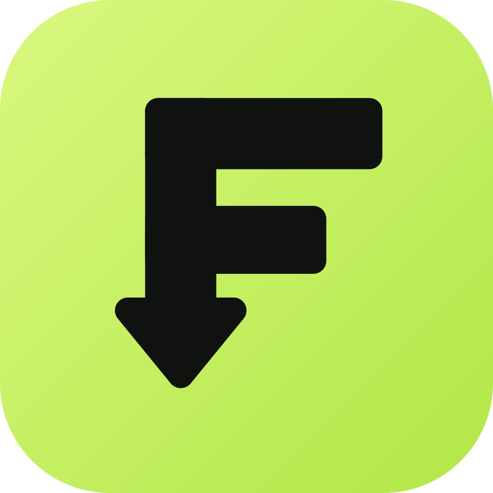

# FRAUM



FRAUM is a cross-platform desktop client for the MiNERVA Archive, with an optional browser client.

The logo is an F whose stem turns into a download arrow. [`assets/icon.svg`](assets/icon.svg) is the source; `icon-256.png` (used as the native window icon) is exported from it.

## Native desktop client

FRAUM's native desktop client is written in Rust with egui. It draws its interface directly, talks to MiNERVA, and downloads selected files over BitTorrent without embedding a browser engine. Node.js is not required when using Cargo directly.

```sh
cargo run --manifest-path native/Cargo.toml
```

Create an optimized native binary with:

```sh
cargo build --manifest-path native/Cargo.toml --release
```

The npm aliases `npm run start:desktop` and `npm run build:native` run these same commands.

Open any Collection, System, Region, or Publisher dropdown and type to filter its tags. Prefix matches appear first; press Enter to select the first suggestion, or click a tag. Choose All to clear that filter.

The Seeding tab is a placeholder with no functionality yet. The Settings tab holds the system-folder option described below and a Presets section with NA, EU and JP checkboxes (all ticked by default) that choose which regions' lists the Presets menu shows; the choice is remembered.

The Queue tab's Presets menu can add curated sets of games to your queue without starting any downloads. Hover a preset to pick one of its lists; games already in your queue are skipped.

You can share your own presets. **Export queue as preset…** at the bottom of the Presets menu saves everything in your queue to a `.json` file (the file name becomes the preset's name), and **Import preset…** adds every file in such a file to your queue (skipping any already queued) and also keeps it in the menu as a preset with an **All Games** list. Imported presets are kept between runs; use **Remove this preset** at the bottom of its submenu to delete one. A preset file looks like `{"name": "My set", "note": "optional", "items": [{"id": 123, "name": "Game (USA).zip", "full_path": "…", "file": {…}, "regions": ["NA"]}]}`; `file` and `regions` are optional. Files without `file` details are looked up in the archive when downloaded, and items with `regions` also get **All Games (NA/EU/JP)** lists that follow the region checkboxes in Settings. Files that aren't valid presets, are over 64 MB, or share a name with a built-in preset are refused.

**Nintendo Classics** has a complete list for each region, built from [Wikipedia's Nintendo Classics list](https://en.wikipedia.org/wiki/Nintendo_Classics) and matched to MiNERVA's No-Intro and Redump collections. The menu shows **All Games (NA)** (362 games), **All Games (EU)** (362) and **All Games (JP)** (352), then a list for each system in each region: **NES (NA)**, **NES (EU)**, **NES (JP)**, **SNES (NA)** and so on, across NES (including a few Famicom Disk System titles), SNES, Game Boy/Color, Nintendo 64, Sega Genesis, Game Boy Advance, GameCube and Virtual Boy (the Genesis lists are named Mega Drive for Europe and Japan). Wikipedia's table has a single "NA/PAL" column, so it can't tell North America from Europe: those two lists hold the same games, each with that region's version of the ROM. Japan is separate and adds the Japan-only titles. Each list is about 9 GB, and about 8 GB of that is the 12 GameCube games (around 700 MB each).

As in the Virtual Console lists, each regional list uses that region's version of a game where MiNERVA has one, with local names (Beyond Oasis is The Story of Thor in Japan) found through the Wikipedia article each title links to, and falls back to another region's dump otherwise. That affects about 12% of the games in the North America list, 27% in Europe and 29% in Japan, mostly because MiNERVA's dumps lack that region's release or I couldn't pair its local name. "SP" variants are skipped because they are not separate ROMs. Three listed games are missing from MiNERVA's dumps and are omitted: Clu Clu Land: Welcome to New Cluclu Land, Dragon Hopper and Zero Racers.

**Virtual Console** has a complete list for each region, built from the Wikipedia lists for the [Wii](https://en.wikipedia.org/wiki/List_of_Virtual_Console_games_for_Wii), [Wii U](https://en.wikipedia.org/wiki/List_of_Virtual_Console_games_for_Wii_U_(North_America)) and [3DS](https://en.wikipedia.org/wiki/List_of_Virtual_Console_games_for_Nintendo_3DS_(North_America)) (Europe means the whole PAL region, including Australia). The menu shows **All Games (NA)** (678 games), **All Games (EU)** (669) and **All Games (JP)** (1,049), then a list for every system in every region where it has games: **NES (NA)**, **NES (EU)**, **NES (JP)**, **SNES (NA)** and so on, across NES/Famicom (including Famicom Disk System), SNES, Nintendo 64, Game Boy/Color, Game Boy Advance, Nintendo DS, TurboGrafx-16 / PC Engine (including CD games), Master System, Genesis (named Mega Drive for Europe and Japan), Game Gear, Neo Geo, Commodore 64, MSX and arcade. A game sold in several regions is in each region's lists. The North America and Europe lists are about 10 GB each and Japan is about 19 GB; most of that is PC Engine CD games of 100–700 MB.

Each regional list uses that region's version of a game where MiNERVA has one, found through the title Wikipedia gives for that region: the North America list has Mega Man X (USA) and the Japan list has Rockman X (Japan). Where I couldn't find a dump for that region, the list falls back to another region's dump of the same game (a USA dump of a game sold in Europe, for example): that affects about 8% of the console games in the North America list, 25% in Europe and 10% in Japan. A game that already has its own region's dump isn't also given an international one, with games linked across regions by the Wikipedia article their title points to. Console games come from MiNERVA's No-Intro and Redump collections, preferring plain retail dumps over betas, prototypes, pirate or unlicensed copies. Neo Geo and arcade games are FinalBurn Neo sets from MiNERVA, saved into `neogeo` and `fbneo` folders; each Neo Geo list starts with the Neo Geo BIOS (`neogeo.zip`), and any parent sets a game needs are queued with it. Eleven listed games could not be matched and are omitted: Clu Clu Land: Welcome to New Clu Clu Land, Cybernoid, Eggy and Fortified Zone 2 (not in MiNERVA's dumps under any name I could find), Shin'ōken (Neo Geo), and the arcade games Solvalou, Starblade, Cyber Sled, Baraduke II, Bosconian and Shanghai (not in the FinalBurn Neo set).

**PlayStation Classic** has a list for each region, built from the game table in [Wikipedia's PlayStation Classic article](https://en.wikipedia.org/wiki/PlayStation_Classic) and matched to MiNERVA's Redump PlayStation collection. Because it covers one system, the menu shows only **All Games (NA)** (20 games, 23 discs), **All Games (EU)** (20 games, 23 discs) and **All Games (JP)** (20 games, 24 discs). Every disc of a multi-disc game is included (Final Fantasy VII, Metal Gear Solid, and Parasite Eve in Japan). The table has one column for North America/PAL, so the NA and EU lists hold the same games, each using that region's disc image: Tekken 3 (USA), Tekken 3 (Europe, Australia) and Tekken 3 (Japan, Asia). Where the Japanese release has a different title, the Japanese disc is used: Battle Arena Toshinden is Toushinden, Resident Evil is Bio Hazard, Super Puzzle Fighter II Turbo is Super Puzzle Fighter II X, and Devil Dice is XI [sai]. Europe's Intelligent Qube is Kurushi. Revelations: Persona never had a European release, so the EU list uses the US disc, as the console did. The lists are about 9–10 GB each, and the games are saved into the `psx` folder.

**NES Classic Edition** has a list for each region, built from the game table in [Wikipedia's NES Classic Edition article](https://en.wikipedia.org/wiki/NES_Classic_Edition) and matched to MiNERVA's No-Intro collections. Like PlayStation Classic it covers one system, so the menu shows only **All Games (NA)**, **All Games (EU)** and **All Games (JP)**, each with 30 games and under 3 MB in total. The table has one NA/PAL column, so the NA and EU lists hold the same games, each using that region's ROM: Europe gets Shadow Warriors for Ninja Gaiden, Probotector II for Super C, and its own Punch-Out!! (North America gets Super C and the Punch-Out!! Featuring Mr. Dream version). The Japan list uses the Famicom titles: Akumajou Dracula, Rockman 2, Ninja Ryuuken Den, Hoshi no Kirby, Makaimura, Mario Open Golf, Super Mario USA and Downtown Nekketsu Monogatari (River City Ransom), and takes The Legend of Zelda, Zelda II and Metroid from the Famicom Disk System, so those three are saved into the `fds` folder and the rest into `nes`. Galaga in North America is the Namco Museum dump, as MiNERVA has no standalone US release.

**Super NES Classic Edition** has a list for each region, built from the game table in [Wikipedia's Super NES Classic Edition article](https://en.wikipedia.org/wiki/Super_NES_Classic_Edition) and matched to MiNERVA's No-Intro Super Nintendo collection. It covers one system, so the menu shows only **All Games (NA)**, **All Games (EU)** and **All Games (JP)**, each with 21 games and about 27 MB in total, saved into the `snes` folder. The table has one NA/PAL column, so NA and EU hold the same games, each using that region's ROM: Europe gets Super Probotector (Contra III), Kirby's Fun Pak (Kirby Super Star), and its own Kirby's Dream Course, Mega Man X and Secret of Mana, and North America and Europe both get Final Fantasy III (the US name of Final Fantasy VI). The Japan list swaps in the Super Famicom titles: Contra Spirits, Super Donkey Kong, Hoshi no Kirby Super Deluxe, Rockman X, Seiken Densetsu 2, Chou Makaimura, Super Formation Soccer II and Super Mario - Yoshi Island, and adds the Japan-only Fire Emblem: Monshou no Nazo, Ganbare Goemon (Mystical Ninja), Panel de Pon and Super Street Fighter II. MiNERVA has no European release of EarthBound, Final Fantasy VI, Star Fox (Star Wing in Europe) or Super Mario RPG, so the EU list uses the US ROMs for those.

**Sega Genesis Mini** and **Sega Genesis Mini 2** have a list for each region, built from the game tables in [Wikipedia's Sega Genesis Mini article](https://en.wikipedia.org/wiki/Sega_Genesis_Mini) and matched to MiNERVA's No-Intro Mega Drive/Genesis and Redump Mega CD/Sega CD collections. Where MiNERVA has the exact ROM the console shipped (the dumps tagged Genesis Mini, Mega Drive Mini or Mini 2), the list uses it; otherwise it uses that region's retail version. The table has one NA/EU column, so NA and EU hold the same games, each using that region's ROM: Europe gets Probotector (Contra: Hard Corps), The Story of Thor (Beyond Oasis) and Castlevania: The New Generation, and Japan gets Vampire Killer, Rockman Mega World, Daimakaimura, Streets of Rage 2 and Shining Force: Kamigami no Isan, for example. The Asia column of the first table is not used, so the Asia-only games (Alien Soldier, OutRun 2019, Shining Force II and Sword of Vermilion) are not in the Mini lists.

The Mini has one system, so its menu shows only **All Games (NA)**, **All Games (EU)** and **All Games (JP)**, each with 42 games and under 50 MB, saved into `megadrive`. Mini 2 adds Sega CD games, so it also has **Sega Genesis (NA)** and **Sega CD (NA)** lists and so on (named Mega Drive and Mega CD for Europe and Japan), saved into `megadrive` and `megacd`. Its lists have 60 games for NA and EU and 59 for Japan, 5.5 GB for NA and EU and 8 GB for Japan, nearly all of it Sega CD discs. Night Trap includes both discs, and Ecco the Dolphin and Ecco: The Tides of Time use the two discs of the Japanese Ecco the Dolphin CD in the Japan list. Two Japan-only titles on Mini 2, Party Quiz Mega Q 2022 and Party Quiz Sega Q, are not in MiNERVA's collections and are left out. Devi & Pii uses the Mini 2 Japanese dump in every region, since it is the only one, and for a few games where MiNERVA has no ROM for a region (Mansion of Hidden Souls in Japan, Sonic CD in Japan, Powerball in Japan) the list falls back to another region's dump.

In the native client, Download saves into your system's Downloads folder (or the folder you choose in the Queue tab). By default each game goes into a subfolder named after its system, using the folder names shared by [RetroBat](https://wiki.retrobat.org/systems-and-emulators/supported-game-systems) and [Batocera](https://wiki.batocera.org/systems): `nes`, `fds`, `snes`, `gb`, `gbc`, `gba`, `n64`, `megadrive` (Genesis), `gamecube`, `virtualboy`, `atarist`, `c64`, `ps3` and so on. About 100 MiNERVA systems are recognized, covering the major Nintendo, Sega, Sony, Atari, NEC and SNK consoles plus many computers and handhelds. A few folders (`pico`, `beena`, `sc3000`, `rx78`, `videopacplus`) exist only in Batocera. Odyssey² is not sorted because the two projects name it differently. Folders are created as needed, so you can point the download folder at RetroBat's or Batocera's `roms` directory. Files from systems FRAUM doesn't recognize, and variants such as aftermarket or private dumps, are saved directly in the download folder. Turn off the **Sort downloads into RetroBat / Batocera system folders** switch in the Settings tab to save everything directly in the download folder instead; the choice is remembered. Progress or errors remain visible across tabs. Use the More menu next to each Download button to add files to the persistent queue. Open the Queue tab to choose a different download folder, remove queued files, or start all queued downloads. Use Remove all to clear the saved queue without cancelling an active download. Items remain in the queue until you remove them.

Torrent data files are opened on demand instead of keeping the entire collection open, so large collections do not require raising your system's open-file limit.

Queued downloads share one BitTorrent session and clean up after each file. Nintendo Classics preset games carry their torrent details, so downloading them needs no ROM-details lookup (queues saved before this are upgraded automatically); if that saved information is ever out of date, FRAUM falls back to a live lookup. For other files, MiNERVA sometimes leaves a request hanging, so FRAUM times out each ROM-details or torrent-metadata request quickly and retries it (up to four and three attempts), showing a "retrying" status. A file that gets no progress for two minutes (for example, when nobody is currently sharing it) is skipped, the rest of the queue continues, and the final status lists what failed. Files already present in the download folder with the expected size are skipped, so you can safely run Download all again to retry only what is missing.

## Releases

Pushing a version tag such as `v1.0.0` to GitHub builds the native client for Windows, Linux, and macOS (Intel and Apple Silicon) and publishes each as a single executable on a GitHub Release: `fraum-windows-x64.exe`, `fraum-linux-x64`, `fraum-macos-arm64`, and `fraum-macos-x64`. They are portable, so there is nothing to install. Linux also gets a `.deb` (`fraum_<version>_amd64.deb`) and an `.AppImage` (`FRAUM-<version>-x86_64.AppImage`), built by `packaging/linux/build-packages.sh`. The workflow runs the native and browser-client tests first. To publish a release:

```sh
git tag v1.0.0
git push origin v1.0.0
```

Running the workflow manually from the Actions tab builds downloadable workflow artifacts but does not publish a release.

### Running a downloaded release

Only use these steps for a copy downloaded from the [official GitHub Releases](https://github.com/pancakers2001/FRAUM/releases) page. The executables are not signed or notarized.

- **Linux:** install the `.deb` (`sudo apt install ./fraum_<version>_amd64.deb`), or make the `.AppImage` executable and run it (it bundles OpenSSL, so it also works on distributions without OpenSSL 3). The bare `fraum-linux-x64` file also works:

  ```sh
  chmod +x FRAUM-<version>-x86_64.AppImage
  ./FRAUM-<version>-x86_64.AppImage
  ```

- **macOS:** Gatekeeper may report that the file is “damaged” or from an unidentified developer. Remove the quarantine flag, then run it (use `fraum-macos-x64` on Intel Macs):

  ```sh
  chmod +x fraum-macos-arm64
  xattr -d com.apple.quarantine fraum-macos-arm64
  ./fraum-macos-arm64
  ```

- **Windows:** double-click `fraum-windows-x64.exe`. If SmartScreen warns about an unrecognized app, choose **More info**, then **Run anyway**.

## Run in a browser

Requires Node.js 18 or later. Install the dependencies once, then start the server:

```sh
npm install
npm start
```

Then open [http://localhost:4173](http://localhost:4173). Set `PORT` to use a different port.

The browser client proxies read-only search and directory requests through the local server. Its Download buttons prepare torrent metadata when focused or hovered, show immediate startup feedback when clicked, then stream only the selected file. Temporary download data is removed when the transfer ends or is cancelled.

## Tests

```sh
npm test
cargo test --manifest-path native/Cargo.toml
```
